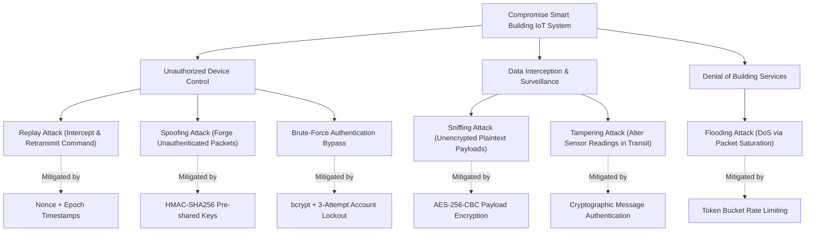
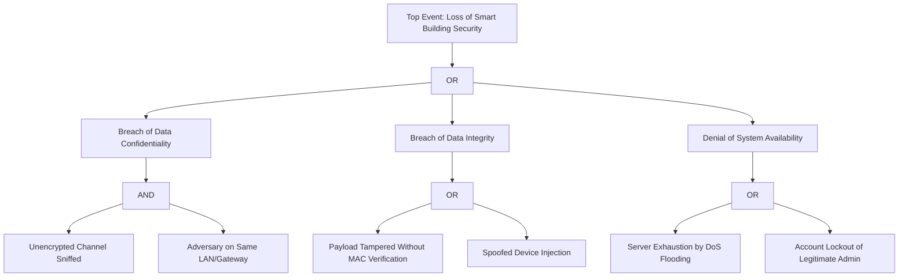

# 📄 SecureIoT: Smart Building Security System
## Final Project & Laboratory Report
**Degree:** Bachelor of Technology (B.Tech) - Computer Science & Engineering / IoT  
**Course:** IoT & Cyber-Physical System Security  
**Affiliation:** Guru Gobind Singh Indraprastha University (GGSIPU)  

---

### Abstract
The Internet of Things (IoT) has become ubiquitous in modern infrastructure such as smart commercial buildings, industrial supervisory control systems, and residential automation. However, resource constraints in embedded devices frequently lead to compromised security architectures, leaving systems vulnerable to sniffing, spoofing, tampering, replay, brute-force, and denial-of-service (DoS) attacks.

This project, **SecureIoT**, implements a comprehensive, lightweight, and demonstrative IoT security platform tailored for a smart building environment. Built with Python, Streamlit, SQLite, and FastAPI, SecureIoT simulates eight smart building IoT devices across four categories (temperature sensors, smart locks, energy meters, and motion detectors). The system contrasts an insecure baseline against a fortified security architecture featuring AES-256-CBC encryption, SHA-256 hashing, HMAC-SHA256 integrity checks, RSA-2048 digital signatures, bcrypt password hashing, Role-Based Access Control (RBAC), topic-level permissions, differential privacy, and cloud API rate limiting.

---

## 1. System Architecture Diagram

```mermaid
graph TD
    subgraph Perception Layer ["1. Perception Layer (Virtual IoT Devices)"]
        D1["TEMP-001 (Floor 1 Temp)"]
        D2["TEMP-002 (Floor 2 Temp)"]
        D3["LOCK-001 (Main Door Lock)"]
        D4["LOCK-002 (Server Room Lock)"]
        D5["ENERGY-001 (Floor 1 Meter)"]
        D6["ENERGY-002 (Floor 2 Meter)"]
        D7["MOTION-001 (Corridor A)"]
        D8["MOTION-002 (Parking Lot)"]
    end

    subgraph Security Gateway ["2. Transport & Security Gateway"]
        AES["AES-256-CBC Encryption"]
        HMAC["HMAC-SHA256 Integrity & Auth"]
        NONCE["Nonce + Timestamp Validator"]
        RL["SlowAPI Rate Limiter"]
    end

    subgraph Cloud Gateway ["3. Cloud Application & Storage Layer"]
        API["FastAPI REST Gateway (JWT)"]
        DB[("SQLite Encrypted Storage")]
        RBAC["RBAC Policy Engine"]
        PRIV["Privacy Engine (Laplace / Pseudo)"]
    end

    subgraph Presentation Layer ["4. Presentation Layer"]
        UI["Streamlit Cybersecurity Dashboard"]
        REP["Audit & Attack Logs (CSV Export)"]
    end

    Perception Layer -->|Telemetry / Sensor State| Security Gateway
    Security Gateway -->|Encrypted & Verified Payloads| Cloud Gateway
    Cloud Gateway -->|Structured Metrics & Events| Presentation Layer
```

---

## 2. Attack Tree Analysis

The following attack tree illustrates the adversary vectors evaluated against the smart building infrastructure:



---

## 3. Fault Tree Analysis (FTA)

The fault tree assesses the primary failure event: **Loss of Smart Building IoT Security & Availability**.



---

## 4. Case Study: Mirai Botnet Analysis

### 4.1 Incident Overview
In September and October 2016, the **Mirai botnet** executed some of the largest distributed denial-of-service (DDoS) attacks in internet history, exceeding 1 Terabit per second (Tbps). Targets included the computer security journalist Brian Krebs (KrebsOnSecurity), the French hosting provider OVH, and DynDNS (which disrupted major platforms including Twitter, Netflix, GitHub, and Spotify).

### 4.2 Exploitation Vectors
Mirai targeted embedded Linux-based IoT devices—principally IP cameras, digital video recorders (DVRs), and residential routers.
1. **Hardcoded Default Credentials:** Mirai scanned the IPv4 address space on TCP ports 23 (Telnet) and 2323 using a dictionary of approximately 60 factory default username/password pairs (e.g., `root:xc3511`, `admin:admin`).
2. **Lack of Rate Limiting:** Compromised devices did not implement exponential backoff or lockout on repetitive failed authentication attempts.
3. **Absence of Firmware Integrity:** Attackers downloaded a lightweight binary payload into memory (`/bin/busybox`) without signature verification.

### 4.3 Lessons & Countermeasures in SecureIoT
The SecureIoT platform integrates direct engineering defenses against Mirai-style vectors:
- **No Default Passwords:** Mandatory registration with 12-round bcrypt salted password hashing.
- **Adaptive Rate Limiting:** Both the FastAPI gateway and attack simulator enforce strict per-IP rate limiting and lockout after 3 failed login attempts.
- **Mutual Authentication:** Challenge-response protocols and device registration matrices prevent rogue botnet inclusion.
- **Cryptographic Firmware Signatures:** RSA-PSS digital signatures demonstrate verifiable firmware updates.

---

## 5. Security Requirements & Comparative Matrix

| Requirement | Threat Mitigated | Insecure Baseline | Fortified Architecture (SecureIoT) |
|---|---|---|---|
| **Confidentiality** | Eavesdropping / Sniffing | Plaintext JSON telemetry | AES-256-CBC encryption with PKCS7 padding |
| **Integrity** | Packet Tampering | No verification check | HMAC-SHA256 message authentication codes |
| **Authenticity** | Device Spoofing | Accepts arbitrary IDs | Pre-shared key HMAC & Challenge-Response |
| **Freshness** | Replay Attacks | Duplicate commands executed | Monotonic nonces and 60-second timestamp windows |
| **Availability** | Flooding / DoS | Server crash / high latency | IP-based token-bucket rate limiting |
| **Access Control** | Privilege Escalation | Unrestricted permissions | 3-Tier RBAC (`admin`, `operator`, `viewer`) |
| **Privacy Preservation** | Identity Inference | Raw MAC and locations broadcast | SHA-256 Pseudonymisation & Laplace Noise |

---

## 6. Conclusion
The SecureIoT project successfully bridges the theoretical concepts of cyber-physical system security with practical, observable implementations. By implementing local attack simulations side-by-side with genuine cryptographic countermeasures, the system provides a clear, verifiable model for securing modern IoT deployments in smart building infrastructures.
